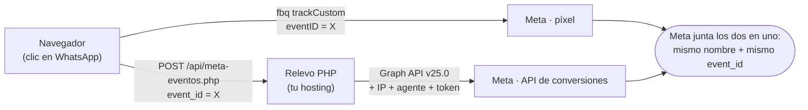

# Píxel de Meta + API de conversiones (CAPI) · Hacienda Primavera

**Conjunto de datos:** «PIXEL HACIENDA» · ID `1879621982910759` · negocio PROArquitectura (`803879177346061`).

| Pieza | Estado |
|---|---|
| Píxel en el navegador | Instalado desde el código (`CONFIG.pixelId` en `index.html`). |
| Relevo del servidor | `api/meta-eventos.php` (PHP, mismo dominio). **Solo funciona cuando existe el archivo secreto con el token** (§3). |
| Activación del relevo en la página | `CONFIG.capiUrl: '/api/meta-eventos.php'` en `index.html` (vacío = solo navegador). |

## 1. Cómo funciona



El **token de acceso nunca está en el navegador ni en el repositorio** (el repositorio es público): vive en un archivo que solo existe en el servidor y que solo lee `api/meta-eventos.php`. Si el archivo no existe, el relevo responde `204` y no hace nada.

## 2. Qué se envía

- **Eventos por servidor:** `ContactoWhatsApp` (la conversión), `ClicIntencionPrecio` y `VioPrecio`. `PageView` va **solo por el navegador**: en el primer instante todavía no existe la cookie `_fbp` y el aporte del servidor sería mínimo. Por eso Meta mostrará la «cobertura» de `PageView` solo del navegador; es lo esperado.
- **Parámetros del evento:** los mismos que ve el píxel (`proyecto`, `boton`, `calidad`, `tipologia`, `proposito`, `forma_pago`, `calificador_completo`, UTM…). El relevo solo deja pasar una lista cerrada de campos y descarta cualquier otro.
- **Datos del visitante:** IP y agente de usuario (los pone el servidor), `fbp` y `fbc` (cookies del píxel; si no hay `_fbc` se arma con el `fbclid` del anuncio). **No hay correo, teléfono ni nombre**: la página no los pide. Consecuencia: la *Calidad de coincidencia de eventos* (EMQ) será baja o media; es normal en una landing que termina en WhatsApp. No se mejora enviando datos personales sin consentimiento.
- **Deduplicación:** el navegador crea un `event_id` por evento y lo manda al píxel (`eventID`) y al relevo. Meta cuenta una sola vez los eventos con el mismo nombre y el mismo `event_id`.

## 3. Puesta en marcha (una sola vez, la hace quien administra el hosting)

1. **Token.** Events Manager → *PIXEL HACIENDA* → **Configuración** → *API de conversiones* → **Generar token de acceso**. Se muestra una sola vez. **No lo pegues en chats, correos ni en el repositorio**; si se filtra, reemplázalo (ver §6).
2. **Archivo secreto.** En hPanel → *Administrador de archivos*, dentro de la carpeta del dominio (**un nivel arriba de `public_html`**), crea `capi-secret.php`:

   ```php
   <?php
   return [
       'pixel_id'        => '1879621982910759',
       'access_token'    => 'PEGA_AQUÍ_EL_TOKEN',
       'test_event_code' => '',   // opcional: el código de «Probar eventos» (TEST…); bórralo al terminar
   ];
   ```

   Si el administrador de archivos no deja salir de `public_html`, crea el archivo **oculto** `public_html/.capi-secret.php` (con punto): el `.htaccess` bloquea desde la web todo lo que empieza por punto. El archivo no se versiona ni lo toca la publicación automática desde GitHub.
3. **Comprobar.** Abre `https://haciendaprimavera.co/api/meta-eventos.php?estado`:
   - `"configurado":true` → el relevo encontró el archivo. Revisa también que `ip_detectada` sea tu IP real (si sale una IP del proveedor, avisa: habría que ajustar la cabecera que se lee).
   - `"configurado":false` → no encontró el archivo (revisa nombre y carpeta).
   - Si el navegador descarga el archivo o muestra código PHP → el plan de hosting no ejecuta PHP (ver §7).
4. **Probar con «Probar eventos».** Events Manager → *PIXEL HACIENDA* → **Probar eventos** → copia el código (`TEST…`) → ponlo en `test_event_code` del archivo secreto → abre el sitio desde el enlace de esa pestaña, elige respuestas y pulsa el botón de WhatsApp. Deben aparecer dos filas por evento (**Navegador** y **Servidor**) con el mismo ID de evento y la marca de **deduplicado**. Cuando todo esté bien, **deja `test_event_code` vacío** (con el código puesto, Meta no cuenta esos eventos como reales).
5. **Activar.** Con el paso 3 en verde, `CONFIG.capiUrl` debe valer `/api/meta-eventos.php` en `index.html` (ya está así si lees esto después de la publicación).

## 4. Qué revisar en Meta (pestaña «Configuración» del conjunto de datos y alrededores)

Los nombres exactos pueden variar según el idioma y la versión de tu panel; esto es lo que importa (verificado: uso de datos y cookies propias, leídos de la cuenta; el resto, por la documentación y guías de Meta):

| Dónde | Qué dejar |
|---|---|
| Uso de datos | «Publicidad y análisis» (ya está así). |
| Cookies propias (first-party) | **Activadas** (ya lo están): `_fbp` y `_fbc` duran más y mejoran la coincidencia. |
| «Seguimiento automático de eventos sin código» (*Track events automatically without code*) | **Apagado.** La página manda sus propios eventos; la detección automática solo sumaría ruido (por ejemplo, un evento por cada botón). |
| Coincidencia avanzada automática | Puede quedar como esté: la página no tiene campos de correo ni teléfono, así que no tiene nada que leer. |
| Cuentas publicitarias | **Asigna la cuenta «Hacienda Primavera» al conjunto de datos** (Configuración del negocio → Orígenes de datos → Conjuntos de datos → asignar activos). Sin esto la campaña no puede elegirlo. |
| Permisos de tráfico → Sitios web (lista de dominios permitidos), si tu panel la muestra | Opcional: agrega `haciendaprimavera.co` para que ningún otro sitio pueda mandar eventos a este conjunto de datos. Después de activarla, repite la prueba del §3.4 y confirma que los eventos de **Servidor** siguen llegando (si dejaran de llegar, quita la restricción). |
| Verificación de dominio | Ya hecha (etiqueta `facebook-domain-verification` en el `<head>`). |
| Eventos agregados / prioridad de eventos | Meta fue retirando esta configuración para eventos web; solo si tu panel todavía te la pide, pon `ContactoWhatsApp` de primero. |

**Conversión personalizada** (para que la campaña optimice hacia personas y no hacia clics repetidos). Hay que crearla **después** de que haya llegado al menos un `ContactoWhatsApp` (hasta entonces Meta no ofrece sus parámetros):

1. Events Manager → **Conversiones personalizadas** → Crear.
2. Origen de datos: *PIXEL HACIENDA* · Evento: `ContactoWhatsApp` · Regla: parámetro `repetido` **no es igual a** `true`.
3. Nombre: «Contacto WhatsApp (Hacienda)». Categoría: *Contacto* o *Cliente potencial*. Sin valor.
4. En el conjunto de anuncios: ubicación de conversión **Sitio web** y evento de conversión = esa conversión personalizada.
5. Opcional, para campañas de calidad: una segunda conversión con la regla `calificador_completo` **es igual a** `true`.

## 5. Las cuatro métricas de la pestaña «Resumen»

- **Calidad de coincidencia de eventos:** esperable baja/media (§2). No es un error.
- **Tasa de deduplicación:** debe ser **alta** (cerca del 100 % de los eventos que salen por las dos vías). Si es baja, el `event_id` no coincide: revisa que `CONFIG.capiUrl` y el píxel estén en la misma versión de `index.html`.
- **Actualización de datos:** los eventos llegan en segundos (se mandan al instante).
- **Cobertura de la API de conversiones:** debe aparecer para `ContactoWhatsApp`, `ClicIntencionPrecio` y `VioPrecio`; `PageView` no (a propósito).

## 6. Seguridad y privacidad

- Token solo en el servidor; el repositorio es público: **nunca** lo pegues en `index.html`, `api/` ni `docs/`. `tools/check_trazabilidad.py` falla si encuentra algo con forma de token de Meta.
- El relevo acepta solo `POST` desde `haciendaprimavera.co`, hasta 8 KB, hasta 60 solicitudes por minuto y por IP, solo los tres eventos de la lista y solo los campos conocidos. Las respuestas de error no incluyen el token.
- Aviso al visitante: el formulario y el pie de página dicen que la página usa el Píxel de Meta (con el resto de herramientas). Si se agrega o quita una herramienta, hay que actualizar esas dos frases.
- Si el token se filtró (por ejemplo, se pegó en un chat), **reemplázalo**: genera uno nuevo en Events Manager, ponlo en el archivo secreto y **revoca el anterior** (Configuración del negocio → Usuarios del sistema, o donde tu panel muestre los tokens del conjunto de datos). Comprueba después en «Probar eventos» que los eventos de Servidor siguen llegando.

## 7. Si algo falla

| Síntoma | Causa probable | Qué hacer |
|---|---|---|
| `?estado` descarga un archivo o muestra código | El hosting no ejecuta PHP | Activar PHP en hPanel; si el plan no lo permite, usar el *Conversions API Gateway* de Meta (todo desde Events Manager, con costo de nube) o una función en Vercel con el mismo contrato (`POST` con `event_name`, `event_id`, `event_source_url`, `fbp`, `fbc`, `custom_data`). |
| `?estado` dice `configurado:false` | El archivo secreto no está donde se busca | Moverlo un nivel arriba de `public_html` o llamarlo `.capi-secret.php` dentro de `public_html`. |
| En «Probar eventos» solo sale **Navegador** | Falta `capiUrl`, el token es inválido o el código de prueba no está puesto | Ver `error_log` de PHP en hPanel: el relevo escribe `[meta-capi] … HTTP …` (nunca el token). |
| En «Probar eventos» salen los dos pero **sin deduplicar** | El nombre o el `event_id` no coinciden | No se debe editar `send()`; revisar versiones. |
| EMQ muy bajo | No hay correo/teléfono | Es esperado; ver §2. |

## 8. Cómo se probó (sin tocar Meta real)

Servidor PHP local + un «Meta» de mentira + Chrome sin cabeza: el relevo rechaza lo inválido (origen, JSON, evento, `event_id`, tamaño, límite), filtra campos, reenvía a `/v25.0/<píxel>/events` con el token solo en el servidor, y el `event_id` del servidor coincide con el `eventID` del píxel. Con la librería real del píxel (envío bloqueado): un solo `PageView`, ninguno por saltos de ancla y `eid` en cada evento.

Fuentes: [Mejores prácticas de la API de conversiones](https://developers.facebook.com/docs/marketing-api/conversions-api/best-practices) · [Graph API v25.0](https://developers.facebook.com/docs/graph-api/changelog/version25.0).
